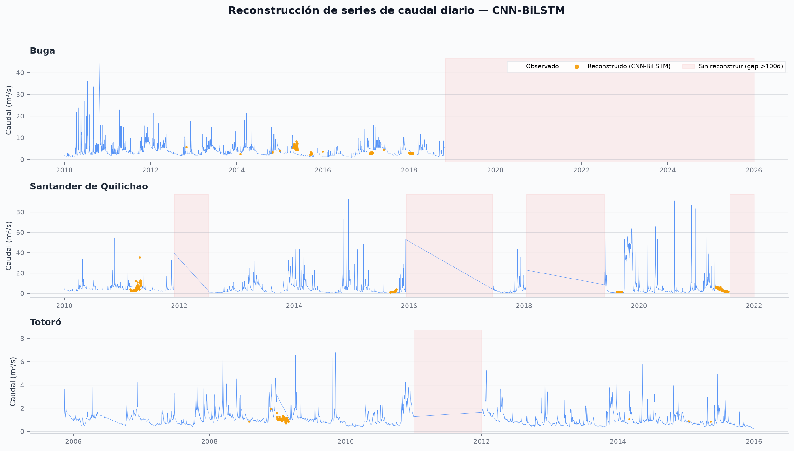

# Reconstrucción de caudal diario con aprendizaje profundo

**Autores:** Oscar Mauricio Montaño Bolaños, Juan José Andrade

Repositorio de soporte del trabajo de maestría sobre reconstrucción de series de caudal diario en tres estaciones del suroccidente colombiano: **Buga** (Valle del Cauca), **Santander de Quilichao** y **Totoró** (Cauca).

Contiene los datos de entrada, los cuadernos de Python con todo el proceso (comparación de modelos de árboles, modelos de aprendizaje profundo, validación y reconstrucción), las series finales reconstruidas, los modelos entrenados y una aplicación web para aplicar los modelos a nuevos datos.



## Resultados principales

El modelo **CNN-BiLSTM** fue seleccionado para la reconstrucción final tras comparar siete modelos (cuatro ML tradicionales y tres DL) en cada estación. La tabla muestra el NSE mediano sobre 20 máscaras aleatorias con 15% de datos faltantes:

| Modelo | Tipo | Buga | Santander | Totoró |
|--------|------|-----:|----------:|-------:|
| MissForest (RF) | ML | 0.56 | 0.68 | 0.79 |
| XGBoost | ML | 0.56 | 0.68 | 0.79 |
| CatBoost | ML | 0.56 | 0.68 | 0.79 |
| LightGBM | ML | 0.56 | 0.68 | 0.79 |
| LSTM | DL | 0.90 | 0.93 | 0.95 |
| BiLSTM | DL | 0.91 | 0.94 | 0.96 |
| **CNN-BiLSTM** | **DL** | **0.93** | **0.95** | **0.98** |

Los modelos ML usan 31 features de ingeniería por fila (lags, leads, interacciones, codificación cíclica) dentro de `IterativeImputer`, optimizados con `RandomizedSearchCV`. Los modelos DL reciben una ventana de 23 días con 10 variables.

## Series reconstruidas y datasets

Los archivos de [`datos/reconstruidos/`](datos/reconstruidos/) contienen:

- **`*_caudal_reconstruido.csv`** — Solo caudal y fuente (3 columnas)
- **`*_dataset_completo.csv`** — Variables climáticas normalizadas + caudal reconstruido (12 columnas), listos para modelado hidrológico (HEC-HMS, SWAT, etc.)

| Estación | Periodo | Días | Observados | Reconstruidos | Sin reconstruir (vacío > 100d) | Dataset completo |
|---|---|---:|---:|---:|---:|---|
| Buga | 2010–2025 | 5 833 | 3 100 | 115 | 2 618 | [Buga_dataset_completo.csv](datos/reconstruidos/Buga_dataset_completo.csv) |
| Santander de Quilichao | 2010–2021 | 4 364 | 2 724 | 230 | 1 410 | [Santander_dataset_completo.csv](datos/reconstruidos/Santander_dataset_completo.csv) |
| Totoró | 2005–2015 | 3 510 | 3 077 | 68 | 365 | [Totoro_dataset_completo.csv](datos/reconstruidos/Totoro_dataset_completo.csv) |

Solo se reconstruyen los vacíos de 100 días consecutivos o menos. Los vacíos más largos se dejan sin valor porque el modelo no tiene suficiente información observada alrededor para estimarlos con confiabilidad.

La descripción de cada columna está en el [diccionario de datos](datos/diccionario_datos.md).

## Estructura

```
├── app_reconstruccion.py         Aplicación Streamlit para reconstruir caudal
├── modelos/                      Modelos CNN-BiLSTM finales (.keras)
├── datos/
│   ├── entrada/                  Variables climáticas (Cenicaña) y caudal observado (IDEAM)
│   ├── reconstruidos/
│   │   ├── *_caudal_reconstruido.csv    Series de caudal (Fecha, Caudal_m3s, Fuente)
│   │   └── *_dataset_completo.csv       Variables climáticas + caudal reconstruido
│   └── diccionario_datos.md
├── notebooks/
│   ├── 01_ml_comparacion_*.ipynb        Comparación de modelos ML (RF, XGBoost, CatBoost, LightGBM)
│   └── 02_dl_reconstruccion_*.ipynb     Modelos DL: LSTM, BiLSTM y CNN-BiLSTM
└── resultados/
    ├── hiperparametros/
    │   ├── mejores_hp_dl.json           Hiperparámetros DL (Hyperband)
    │   └── mejores_hp_ml.json           Hiperparámetros ML (RandomizedSearchCV)
    ├── ablacion/                        Estudio de ablación de variables
    └── tablas/                          Tablas de métricas por estación
```

Los cuadernos se publican con sus salidas guardadas, de modo que las tablas y figuras se pueden consultar directamente en GitHub sin ejecutar nada.

## Modelos de aprendizaje profundo

Las tres arquitecturas reciben una ventana de 23 días (15 previos, el día a estimar y 7 posteriores) con 10 variables: caudal pasado en escala logarítmica, precipitación, temperatura media, humedad relativa media, evaporación, radiación solar y cuatro variables cíclicas de estacionalidad.

| Modelo | Arquitectura | Parámetros |
|---|---|---:|
| LSTM_v2 | LSTM(64) → Dropout → LSTM(32) → Dropout → Dense(8) → Dense(1) | 31 889 |
| BiLSTM_v2 | BiLSTM(64) → Dropout → BiLSTM(32) → Dropout → Dense(32) → Dense(1) | 81 729 |
| CNN_BiLSTM_v2 | Conv1D(32, k=7) → Dropout → BiLSTM(64) → Dropout → BiLSTM(32) → Dropout → Dense(16) → Dense(1) | 94 209 |

Hiperparámetros elegidos con Hyperband ([`mejores_hp_dl.json`](resultados/hiperparametros/mejores_hp_dl.json)): dropout 0,1, Adam con tasa de aprendizaje 0,001, pérdida MSE. El modelo usado para la reconstrucción final es **CNN_BiLSTM_v2**.

## Modelos de machine learning tradicional

Los cuatro modelos usan 31 features de ingeniería por fila dentro de `IterativeImputer` de scikit-learn:

- **Climáticas (4):** temperatura media, humedad relativa media, precipitación, evaporación
- **Precipitación pasada (6):** P_lag1 a P_lag6
- **Precipitación máxima (1):** P_max7d
- **Precipitación futura (3):** P_lead1 a P_lead3
- **Caudal pasado (6):** Q_lag1 a Q_lag6
- **Caudal futuro (5):** Q_lead1 a Q_lead5
- **Interacciones (2):** P×Hmd, T×Rad
- **Estacionalidad (4):** sin_day, cos_day, sin_month, cos_month

Hiperparámetros optimizados con `RandomizedSearchCV(n_iter=15)` × `TimeSeriesSplit(3 folds)` ([`mejores_hp_ml.json`](resultados/hiperparametros/mejores_hp_ml.json)).

## Cómo ejecutar

Requiere Python 3.11 o superior.

**Aplicación:**

```bash
pip install -r requirements.txt
streamlit run app_reconstruccion.py
```

**Cuadernos:**

```bash
pip install -r requirements-notebooks.txt
cd notebooks
jupyter notebook
```

Los cuadernos leen los datos desde `../datos/entrada/` y los modelos desde `../modelos/`, por lo que deben abrirse desde la carpeta `notebooks/`. Los cuadernos `02_dl_*` cargan el modelo final guardado; para reentrenarlo, cambie `FORCE_RETRAIN = True`.

## Citar

Si usa estos datos o código, por favor cite:

```bibtex
@mastersthesis{montano2026reconstruccion,
  author  = {Montaño Bolaños, Oscar Mauricio},
  title   = {Reconstrucción de series de caudal diario mediante aprendizaje
             profundo en estaciones del suroccidente colombiano},
  school  = {Universidad Autónoma de Occidente},
  year    = {2026},
  address = {Cali, Colombia},
  note    = {Repositorio: \url{https://github.com/msorin81/reconstruccion-caudal}}
}
```

## Fuentes de datos

- **Caudal diario:** Instituto de Hidrología, Meteorología y Estudios Ambientales (IDEAM).
- **Variables climáticas:** Centro de Investigación de la Caña de Azúcar de Colombia (Cenicaña), red de estaciones meteorológicas automáticas.

## Licencia

- Código: [MIT](LICENSE).
- Datos y series reconstruidas: [CC BY 4.0](LICENSE-DATA.md), citando además a las fuentes originales (IDEAM y Cenicaña).
